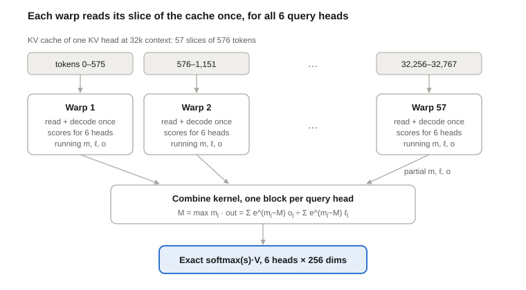
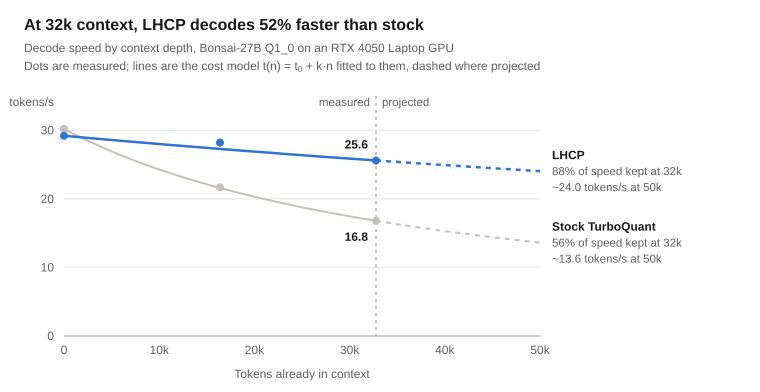

# Long Horizon Context Protection (LHCP)

November 25, 2026 · Duckie

## Summary

LHCP keeps decode speed nearly flat as the context fills. On Bonsai-27B (1-bit `Q1_0`) on an RTX 4050 Laptop GPU, decode at 32k context runs at **25.6 tokens/s with LHCP versus 16.8 with the stock kernels (+52%)**. That is ~88% of its empty-context speed, instead of ~56%.

The idea in one line: every generated token must read the whole KV cache of the attention layers, so each cached token costs *(bytes per cached token) ÷ (bandwidth actually achieved)*. LHCP shrinks the bytes (duckie KV codecs) and raises the achieved bandwidth (a decode kernel that reads each KV byte once, spread over the whole GPU). At 32k context the extra time per token falls from ~26 ms to ~5 ms.

LHCP is implemented in duckie.cpp ([`ggml/src/ggml-cuda/fattn-duckie.cu`](https://github.com/duckiedevelop/duckie.cpp/blob/duckie/ggml/src/ggml-cuda/fattn-duckie.cu)), on top of the TurboQuant fork of llama.cpp.

## Why decode slows as context grows

Each generated token costs a fixed weight read plus a KV read that grows with the context. Decode produces one token at a time, so the GPU does little math per byte loaded, and memory bandwidth sets the speed.

- **Fixed part:** every weight is read once per token. For Bonsai that is ~3.8 GB, about 33 ms per token on this laptop, at any context length.
- **Growing part:** each full-attention layer scores the new token against every cached token, so it reads the K and V vectors of all *n* cached tokens. Double the context, double this read.

Bonsai is a hybrid model. 48 of its 64 layers are Gated DeltaNet layers with a fixed-size recurrent state, so their cost never grows. Only the 16 full-attention layers grow, and those are what LHCP targets.

The attention read is bandwidth-bound, not compute-bound. Per cached token and layer, the kernel loads 1,616 bytes (`q8_0` K + `duckie4` V) and does 24,576 FLOPs (6 query heads × 4 KV heads × 256 dims × 2 products × 2 FLOPs). That is ~15 FLOP per byte, well under the card's ridge point of ~60 FLOP per byte (~12 TFLOPS FP32 ÷ ~192 GB/s). So the floor for attention is set by bytes moved, and the question is how close a kernel gets to it.

## The math: a cost model for decode

Time per token is a constant plus a term linear in the context length *n*:

```math
t(n) = t_0 + k\,n, \qquad k = \frac{L_g \, H_{kv} \, D \, (\beta_K + \beta_V)}{\eta \, B}
```

| Symbol | Meaning | Bonsai-27B on RTX 4050 Laptop |
| --- | --- | --- |
| $t_0$ | time per token at empty context (weights + fixed ops) | ~33–34 ms |
| $k$ | extra time per token for each cached token (the slope) | stock 806 ns, LHCP 147–182 ns |
| $L_g$ | layers whose KV cache grows | 16 of 64 |
| $H_{kv}$ | KV heads per layer | 4 (shared by 24 query heads) |
| $D$ | head dimension | 256 |
| $\beta_K$, $\beta_V$ | bytes per cached K / V element | f16 2 · q8_0 1.0625 · duckie4 0.516 · duckie3 0.391 |
| $B$ | peak memory bandwidth | ~192 GB/s |
| $\eta$ | share of $B$ the attention kernel achieves | stock ~0.15–0.17 · LHCP ~0.6–0.9 |

Speed is the inverse of time. Dividing by the empty-context speed gives the **retention** $R(n)$, the share of decode speed left at context *n*:

```math
s(n) = \frac{1}{t(n)}, \qquad R(n) = \frac{s(n)}{s(0)} = \frac{1}{1 + n / n_{1/2}}
```

Retention depends on one number, the **half-speed context** $n_{1/2}$, where the growing part equals the fixed part and decode runs at half its empty-context speed:

```math
n_{1/2} = \frac{t_0}{k} = \frac{t_0 \, \eta \, B}{L_g \, H_{kv} \, D \, (\beta_K + \beta_V)}
```

Every factor in $n_{1/2}$ is a lever, and because they multiply, gains compound:

- **$\beta$ (bytes per element): the codec.** `q8_0` K + `duckie4` V store 1.58 bytes per K+V element pair versus 4 for f16, a 2.5× gain. `duckie4` K + `duckie3` V store 0.91, a 4.4× gain.
- **$\eta$ (achieved bandwidth): the kernel.** Going from ~0.16 to ~0.6–0.9 is a 4–6× gain. This is the main LHCP contribution.
- **$L_g$, $H_{kv} \cdot D$: the architecture.** Fixed per model. Hybrids, sliding-window layers, GQA and MLA all shrink them. The runtime can only exploit what the model gives.
- **$t_0$: the weight read.** A heavier per-token weight read hides attention better. MoE and small models read few weight bytes per token, so they feel context growth sooner.

Rule of thumb: when weights and KV stream at similar efficiency, **decode speed halves at the context where the KV read per token equals the weight read per token.**

## Worked numbers for Bonsai-27B

With `q8_0` K and `duckie4` V, each cached token costs 25.9 KB across the 16 growing layers. At 32k context that is 847 MB read per generated token, a floor of 4.4 ms at 192 GB/s.

```math
b_{tok} = L_g H_{kv} D (\beta_K + \beta_V) = 16 \times 4 \times 256 \times (1.0625 + 0.5156) = 25{,}856\ \text{bytes}
```

| KV cache (K / V) | Bytes per cached token | Read per token at 32k | Bandwidth floor at 32k | Cache size at 50k |
| --- | --- | --- | --- | --- |
| f16 / f16 | 65.5 KB | 2.15 GB | 11.2 ms | 3.28 GB (does not fit beside 3.8 GB of weights on 6 GB) |
| q8_0 / duckie4 | 25.9 KB | 847 MB | 4.41 ms | 1.29 GB |
| duckie4 / duckie4 (runs as q8_0 K on Bonsai) | 16.9 KB | 554 MB | 2.88 ms | 845 MB |
| duckie4 / duckie3 | 14.8 KB | 487 MB | 2.53 ms | 742 MB |
| duckie3 / duckie3 | 12.8 KB | 419 MB | 2.18 ms | 640 MB |

The measured slope shows how close each kernel gets to that floor. Both rows use `q8_0` / `duckie4` and the same 1-bit matvec kernel; only the attention kernel differs.

| Attention kernel | Extra time per token at 32k | Slope $k$ | Implied $\eta$ (floor ÷ extra time) | $n_{1/2}$ | Retention at 32k |
| --- | --- | --- | --- | --- | --- |
| Stock TurboQuant | 26.4 ms | 806 ns | 0.17 | ~41k tokens | 0.56 |
| LHCP | 4.8–6.0 ms | 147–182 ns | 0.74–0.92 | ~180k–230k tokens | 0.85–0.88 |

The LHCP ranges come from two depth-0 baselines: 29.2 tokens/s (the LHCP run) and 30.2 (the stock run). At depth 0 the two kernels tie within run-to-run noise; a second pair of runs gave 29.8 and 29.9. Timing one attention layer on its own (407–483 µs against a 276 µs floor) gives a lower $\eta$ of 0.57–0.68. Either way, LHCP runs 4–6× closer to the bandwidth floor than the stock kernel.

Projected to your 50k context (not measured), with $s = 1 / (t_0 + k \cdot 50{,}000)$: **LHCP ~23.7–24.0 tokens/s, stock ~13.6 tokens/s.**

## The LHCP kernel

The kernel raises $\eta$ by removing redundant reads, keeping every SM busy, and hiding memory latency. Each technique below has a small piece of math behind it.

### 1. Read each byte once: pack the GQA group

Bonsai has $G = H_q / H_{kv} = 24 / 4 = 6$ query heads per KV head. The stock decode kernel loaded and decoded every K/V row once per query head. LHCP gives one warp a KV head and all 6 of its query heads, so each row is loaded and decoded once and used 6 times.

```math
\frac{\text{decode work (stock)}}{\text{decode work (LHCP)}} = \frac{H_q \, n \, D}{H_{kv} \, n \, D} = G = 6
```

### 2. Split the sequence, then merge exactly

At decode there is one query token and only 4 KV heads, too little parallel work for 20 SMs. So the *n* cached tokens are cut into slices, one per warp (flash-decoding). Each warp keeps a running max $m$, a running sum $\ell$ and a running output $o$ over its slice. For each new tile of scores $s_t$ and values $v_t$:

```math
m' = \max\big(m, \max_t s_t\big), \quad \alpha = e^{\,m - m'}, \quad \ell' = \alpha \ell + \sum_t e^{\,s_t - m'}, \quad o' = \alpha o + \sum_t e^{\,s_t - m'} v_t
```

A small combine kernel then merges the slices $j$ with the global max $M$:

```math
M = \max_j m_j, \qquad \text{out} = \frac{\sum_j e^{\,m_j - M} \, o_j}{\sum_j e^{\,m_j - M} \, \ell_j}
```

The merge is exact, not an approximation. Since $e^{m_j - M} \cdot e^{s_i - m_j} = e^{s_i - M}$, the sums over slices become sums over every token, which is the softmax numerator and denominator:

```math
\sum_j e^{\,m_j - M} \ell_j = \sum_i e^{\,s_i - M}, \qquad \text{out} = \frac{\sum_i e^{\,s_i - M} v_i}{\sum_i e^{\,s_i - M}} = \operatorname{softmax}(s) \, V
```



*Split-KV decode for one KV head at 32k context · 57 warps, one merge*

Every cached byte is read by exactly one warp, and the only extra traffic is the small partial results the combine step merges.

### 3. Softmax in base 2

GPUs compute $2^x$ in one instruction (`ex2`), and $e^x = 2^{x \log_2 e}$. LHCP folds the attention scale and $\log_2 e$ into the query once per head, so every score is already in base 2. Ratios are unchanged, so the result is identical:

```math
\tilde q = q \cdot \text{scale} \cdot \log_2 e, \qquad \tilde s_i = \tilde q \cdot k_i + \log_2 e \cdot \text{mask}_i, \qquad 2^{\,\tilde s_i - \tilde m} = e^{\,s_i - m}
```

### 4. Codebook lookups in shared memory

A `duckie4` value decodes as $\hat x = \text{norm} \cdot c[\text{idx}]$, with idx one of 16 centroids. Shared memory has 32 banks; a 16-entry float table sits in 16 different banks, so a warp's 32 lookups finish in one pass (lanes reading the same entry get a broadcast). Constant memory serves one address per pass, so 32 lanes with up to 16 different indices could need up to 16 passes.

### 5. Transpose-reduce the dot products

Each lane holds 8 of the 256 dims, so a dot product is a sum across 32 lanes. A step covers $P = 4$ cached tokens × $G = 6$ heads, so $N = 24$ partial sums per lane. Reducing each with 5 butterfly shuffles costs $5N = 120$ shuffles. Halving rounds instead send half of the remaining values each round:

```math
\underbrace{\tfrac{N}{2} + \tfrac{N}{4} + \tfrac{N}{8}}_{\text{halving rounds}} + \underbrace{2 \cdot \tfrac{N}{8}}_{\text{last two butterflies}} = \tfrac{9N}{8} = 27 \quad (N = 24)
```

### 6. Exactly one full wave of work

When the work fills the GPU's resident capacity exactly, all SMs finish together. One block too many starts a second wave that leaves almost every SM idle. So LHCP sizes the slices from the measured occupancy:

```math
T = \frac{\text{SMs} \times \text{blocks per SM} \times \text{warps per block}}{H_{kv}} = \frac{20 \times 3 \times 4}{4} = 60 \ \text{warps per KV head}
```

At $n = 32{,}768$: 32,768 / 60 = 546, rounded up to whole 32-token tiles = 576 tokens per warp, 57 slices per head, 15 blocks per head × 4 heads = 60 blocks. That is exactly the 60 blocks the GPU holds at once.

### 7. A register budget that buys occupancy

Each thread holds the query (6 heads × 8 dims = 48 registers), the output accumulators (48), max and sum (12), the 24 partial sums and 8 decoded K values, plus addresses: about 168 registers. An SM has 65,536 registers, handed out per warp in units of 256:

```math
\left\lfloor \frac{65{,}536}{168 \times 32} \right\rfloor = 12 \text{ warps} = 3 \text{ blocks}, \qquad \left\lfloor \frac{65{,}536}{176 \times 32} \right\rfloor = 11 \text{ warps} = 2 \text{ blocks}
```

The compiler's natural 172 registers round up to 176 and fit only 2 blocks. Capping at 168 (a launch bound of 3 blocks per SM) gave 50% more resident warps with zero spills. More warps keep more loads in flight. By Little's law, saturating ~192 GB/s with roughly 0.5 µs of memory latency needs ~96 KB in flight, about 5 KB per SM.

### 8. The rotation costs the kernel nothing

TurboQuant rotates K, V and Q with an orthogonal Walsh–Hadamard matrix $H$ before quantizing. Because $H^\top H = I$, scores are unchanged in the rotated domain, so the kernel works on rotated vectors directly. The output is rotated back once per head afterwards.

```math
(Hq) \cdot (Hk) = q^\top H^\top H \, k = q \cdot k
```

## Measured results



*llama-bench, 2026-11-25 · tg64 at depths 0 / 16k / 32k, 2 reps · q8_0 K + duckie4 V, `-ngl 99 -fa 1 -b 256 -ub 128`*

The linear cost model predicts the 16k points it was not fitted to: 27.3 tokens/s for LHCP (measured 28.2) and 21.6 for stock (measured 21.7). At depth 0 the two kernels tie within run-to-run noise (±1.4 tokens/s on the LHCP run; a second pair of runs gave 29.8 vs 29.9).

One attention layer at decode (24 query heads, 4 KV heads, head dim 256), timed with `test-backend-ops perf`:

| KV cache (K / V) | Context | Stock kernel | LHCP kernel | Speedup |
| --- | --- | --- | --- | --- |
| q8_0 / duckie4 | 32k | 1,811 µs | 407–483 µs | ~4× |
| duckie4 / duckie3 | 64k | 8,344 µs | ~820 µs | ~10× |

Correctness against the CPU reference (`test-backend-ops`): 796 of 796 flash-attention cases at head dim 256, covering every KV type, mask, GQA ratio and batch size, all pass. `test-turbo-quant` and `test-quantize-fns` are clean.

## Applying LHCP to other models

The same formula ranks any model. Using the rule of thumb (weights and KV streamed at similar efficiency), $n_{1/2}$ ≈ weight bytes per token ÷ KV bytes per cached token:

```math
n_{1/2} \approx \frac{W}{L_g \, H_{kv} \, D \, (\beta_K + \beta_V)}
```

| Model (class) | Weights read per token | Growing layers × KV heads × head dim | $n_{1/2}$ with f16 KV | $n_{1/2}$ with duckie4 / duckie3 KV |
| --- | --- | --- | --- | --- |
| Bonsai-27B Q1_0 (hybrid) | 3.8 GB | 16 × 4 × 256 | ~58k | ~256k |
| Llama-3.1-8B Q4_K_M (dense) | ~4.9 GB | 32 × 8 × 128 | ~37k | ~165k |
| Qwen3-30B-A3B Q4 (MoE, ~3.3B active) | ~2.0 GB | 48 × 4 × 128 | ~20k | ~90k |

Model shapes are approximate, from published configs recalled from memory and not re-checked. The rule of thumb is conservative: Bonsai's measured $n_{1/2}$ (~180k–230k with `q8_0` / `duckie4`) beats its rule-of-thumb value (~147k), because the weight read does not run at full bandwidth either. The table also assumes a kernel near the floor; at the stock kernel's $\eta$ ≈ 0.16, divide every $n_{1/2}$ by about 6.

How each model class maps onto the formula:

- **Dense, every layer global** (Llama-style): $L_g$ is every layer, so all three levers matter and the absolute gains are largest.
- **MoE**: $W$ counts only the active experts, so $t_0$ is small and attention dominates early. These models gain the most in relative terms.
- **Sliding-window and hybrid** (Gemma-style local/global, DeltaNet or Mamba hybrids): only the global layers count in $L_g$, so the slope is already gentle. The kernel just has to stay efficient on those few layers.
- **MLA** (DeepSeek-style): every query head reads one shared compressed latent per token. That is GQA packing with $G$ equal to the head count: read the latent once, use it for all heads.
- **Speculative decoding**: the $T$ draft tokens checked in one step all attend to the same cache. Packing them as extra query heads ($G_{eff} = G \times T$) reads the cache once per step, so the cost per accepted token divides by the mean number of tokens accepted per step.

To port LHCP to a new model:

1. Measure the slope: run `llama-bench` at depths 0 and 32k, take $k = (1/s(32k) - 1/s(0)) / 32{,}768$, and compare it with the bandwidth floor to get $\eta$.
2. Pick the codec ($\beta$). K is more sensitive than V, so higher-precision K with a smaller V is the usual split.
3. Template the kernel on head dim $D$, group size $G$ (or $G \times T$), and codec. Keep q + accumulators ($2 \times G \times D / 32$ registers) under budget; past it, split the group over two warps or hold q in half precision.
4. Size slices to one full wave from the occupancy API, as in section 6 of the kernel.
5. Check against the CPU reference (`test-backend-ops`) for every shape, and fall back to the stock kernel for anything unhandled.

## Limits, prior work and next steps

LHCP lowers the slope; it does not change the shape. Retention still follows $1 / (1 + n / n_{1/2})$, so decode keeps slowing as context grows, about 5× more slowly than before. Bending the curve below linear would mean reading fewer cached tokens (sparse attention), which trades away accuracy.

Current limits:

- **Shapes:** head dim 256, GQA ratios 4, 6 and 8, one query token per step, NVIDIA GPUs. f16 + f16 caches go to the stock kernel, which handles them better at 64k. Everything else falls back automatically.
- **Prefill is unchanged.** Processing a prompt is compute-bound and uses the stock kernels.
- **Measurement noise.** Laptop boost clocks move single runs by 5–20%, and $\eta$ assumes a 192 GB/s peak. The 50k figures are projections from the 32k slope, not measurements.

Prior work: none of the kernel techniques are new. The online softmax and exact merge come from the FlashAttention line of work, and slicing the sequence at decode is Flash-Decoding. FlashInfer and FlashMLA use the same packing ideas. The KV codecs are TurboQuant ([arXiv 2504.19874](https://arxiv.org/abs/2504.19874)), as implemented in TheTom's llama.cpp fork. LHCP applies these to codebook-quantized KV caches and tunes them for a 6 GB Ada laptop GPU.

Next steps:

- [ ] Generalize the kernel: templated head dim, GQA 1–16, multi-token (speculative) packing, attention sinks and logit softcap
- [ ] Cut registers further (half-precision q) to reach 4 blocks per SM without spills
- [ ] Measure 50k context directly with `duckie4` / `duckie3`
